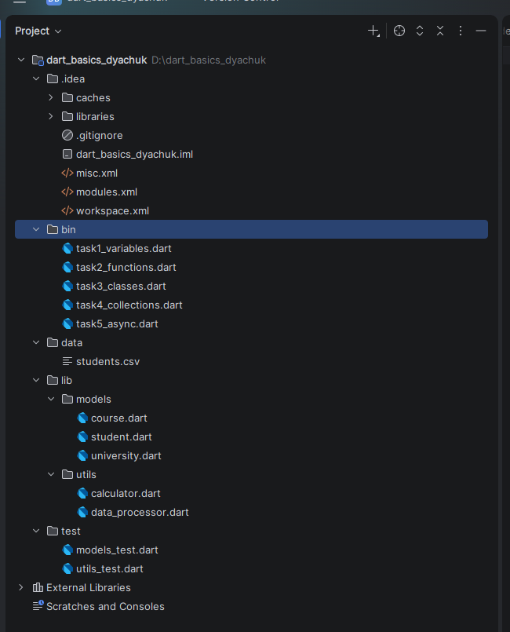
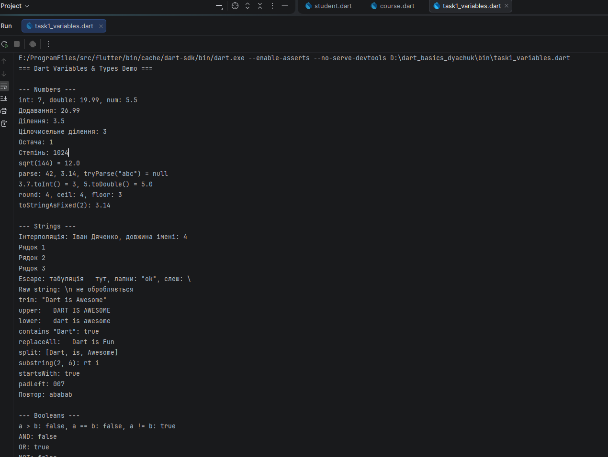
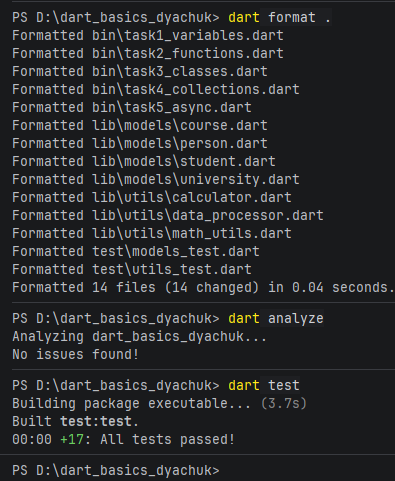

# dart-basics-dyachuk

Практична робота 4. Основи мови Dart.
Дисципліна: Програмування для мобільних платформ.
Автор: Дячук Олександр Русланович, група alk-44

## Опис проєкту

Консольні програми на Dart: типи даних і null safety, функції та замикання, ООП (система управління університетом), колекції та обробка даних, асинхронне програмування і робота з файлами. Код покрито unit-тестами.

| Завдання | Файл | Що демонструє |
|---|---|---|
| 1 | `bin/task1_variables.dart` | числа, рядки, bool, колекції, null safety |
| 2 | `bin/task2_functions.dart` | функції, named-параметри, рекурсія, замикання, калькулятор, аналіз тексту |
| 3 | `bin/task3_classes.dart` | класи, наслідування, поліморфізм, CRUD |
| 4 | `bin/task4_collections.dart` | List/Set/Map, обробка CSV, звіти |
| 5 | `bin/task5_async.dart` | Future, Stream, JSON-файли, таймаути |

## Структура проєкту

```
dart_basics_dyachuk/
├── bin/        task1..task5 (точки входу)
├── lib/
│   ├── models/ person.dart, student.dart, course.dart, university.dart
│   └── utils/  calculator.dart, math_utils.dart, data_processor.dart
├── test/       models_test.dart, utils_test.dart
├── data/       students.csv, students.json, report.txt
├── docs/       скриншоти, UML, текстові виводи
└── pubspec.yaml
```

## Встановлення Dart SDK

Потрібен Dart 3.0.0+ (використано 3.13.5).

1. Завантажити SDK з https://dart.dev/get-dart або встановити Flutter SDK (Dart входить до нього).
2. Перевірити: `dart --version`
3. Клонувати репозиторій і встановити залежності:

```
git clone https://github.com/oDyachuk/dart-basics-dyachuk.git
cd dart-basics-dyachuk
dart pub get
```

## Запуск

Команди виконуються з кореня проєкту (Task 4 і 5 працюють з файлами в `data/`).

```
dart run bin/task1_variables.dart
dart run bin/task2_functions.dart
dart run bin/task3_classes.dart
dart run bin/task4_collections.dart
dart run bin/task5_async.dart
```

Якість коду:

```
dart format .
dart analyze
dart test
```

## Приклади використання класів

```dart
import 'package:dart_basics_dyachuk/models/course.dart';
import 'package:dart_basics_dyachuk/models/student.dart';
import 'package:dart_basics_dyachuk/models/university.dart';

final uni = University(name: 'KNU');
final student = Student(
  id: 'S1', firstName: 'Олена', lastName: 'Коваль',
  birthDate: DateTime(2004, 3, 12), year: 2,
);
uni.addStudent(student);

student.enrollInCourse('CS101');
student.addGrade('CS101', 90);
print(student.gpa);                 // 90.0
print(student.getPassedCourses());  // [CS101]

final course = Course(
  id: 'CS201', name: 'ООП', description: 'Класи', credits: 5,
  instructor: 'І. Бондар', prerequisites: ['CS101'],
);
print(course.canStudentEnroll(student)); // true
print(uni.generateStatistics());
```

## Результати виконання

### Структура проєкту в IDE


### Завдання 1. Змінні та типи


Повний вивід: [docs/task1_output.txt](docs/task1_output.txt)

### Завдання 2. Функції

Повний вивід: [docs/task2_output.txt](docs/task2_output.txt)

### Завдання 3. ООП: система університету

Повний вивід: [docs/task3_output.txt](docs/task3_output.txt)

UML-діаграма: [docs/uml.md](docs/uml.md) (Mermaid, відображається на GitHub)

Ключові рішення:
- `Person` (abstract) винесено в окремий файл, щоб уникнути циклічного імпорту між `student.dart` і `university.dart`;
- `Student` і `Professor` наслідують `Person` (поліморфізм, `List<Person>`);
- `Course.canStudentEnroll` перевіряє пререквізити через `Student.getPassedCourses()` (оцінка ≥ 60).

### Завдання 4. Колекції та обробка даних

- Вхідні дані: [data/students.csv](data/students.csv)
- Звіт: [data/report.txt](data/report.txt)
- Повний вивід: [docs/task4_output.txt](docs/task4_output.txt)

### Завдання 5. Асинхронність

- Повний вивід: [docs/task5_output.txt](docs/task5_output.txt)
- Дані: [data/students.json](data/students.json)

Порівняння продуктивності (3 запити по ~1 с):

| Підхід | Час |
|---|---|
| Послідовні `await` | ~3030 мс |
| `Future.wait` (паралельно) | ~1010 мс |

`Future.wait` запускає запити одночасно, тому час дорівнює найдовшому запиту, а не сумі.

## Тестування

17 unit-тестів (моделі, калькулятор, математичні функції, обробка даних). `dart analyze`: No issues found.



Покриття:

```
dart pub global activate coverage
dart test --coverage=coverage
dart pub global run coverage:format_coverage --lcov --in=coverage --out=coverage/lcov.info --report-on=lib
```


## Труднощі та розв'язання

- Команда `dart` з `flutter\bin` викликала `git`, якого немає: запускав `dart.exe` напряму з `cache\dart-sdk\bin`.
- IDE додавала відносні імпорти `../lib/...`: замінив на `package:dart_basics_dyachuk/...`, аналізатор чистий.
- Кирилиця у файлах виводу спотворювалась: виставив UTF-8 у консолі PowerShell.
- `factorial`/`fibonacci` винесено в `lib/utils/math_utils.dart`, щоб тести не залежали від `bin/`.
- Git не встановлено: коміти робив через веб-інтерфейс GitHub.

## Декларація використання ШІ
**Під час виконання роботи хасоби ШІ не використовувались.**
